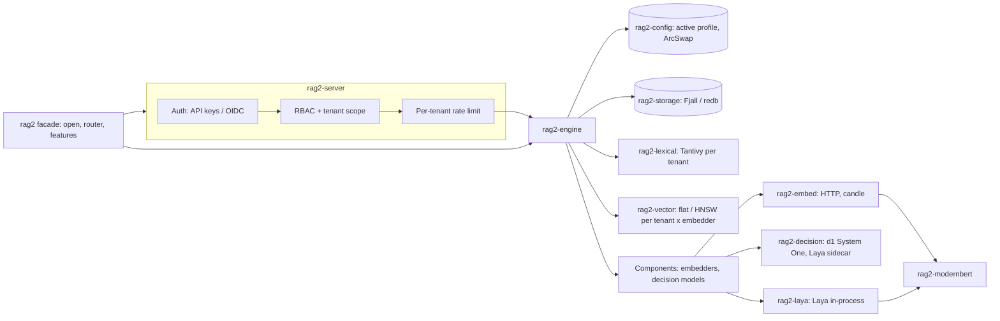
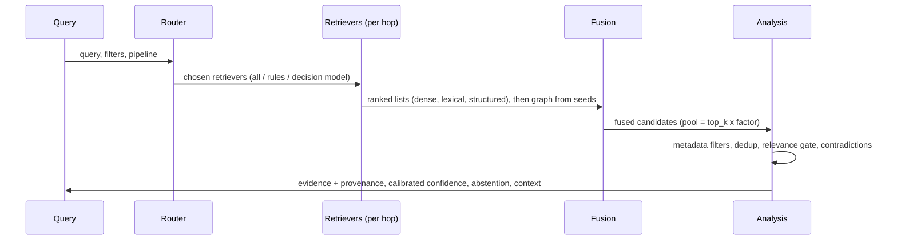

# Architecture

RAG2 is a modular monolith: one process, crates with narrow interfaces, every implementation
chosen by configuration. Components talk through the versioned traits in `rag2-core`
(`INTERFACE_VERSION`), never through each other's internals.

Integration points: `rag2::open(dir)` embeds the engine; `rag2::router(engine)` mounts the HTTP
API into an existing axum/tower server; `rag2 serve` runs it standalone (REST, gRPC, MCP).
Features select components at build time (`decision`, `models`, `plugins`, `server`); the
profile selects them at run time.

## Write path

1. Validate limits and quota; drop documents whose content hash is unchanged.
2. Chunk (paragraph > sentence > word boundaries, overlap, strict progress).
3. Reserve chunk ids once per request; embed every chunk of the request in one batched call per
   embedder.
4. One atomic storage batch for the whole request: records, chunks, vectors, metadata index,
   deletions of replaced chunks, document count, and the tenant's **generation** counter.
5. Update derived indexes (lexical, vector). Lexical commits record the generation they reflect.

Storage is the source of truth. Derived indexes are rebuilt from it: at startup, a lexical index
whose committed generation differs from storage's is rebuilt; vector indexes are rebuilt in
memory from stored vectors. A crash between steps 4 and 5 therefore loses nothing.

## Read path

The active profile is read once per request (`ConfigManager::current`, a lock-free `Arc`), so
an activation never changes behaviour mid-request. Responses are cached under a key that includes
the tenant's storage generation, the lexical committed generation and the config version, so a
write, a commit or an activation makes earlier entries unreachable.

## Tenancy

`TenantId` is a validated type (`[a-z0-9_-]`, 64 bytes max) required by every storage call.
Keys are `tenant \0 ...`; a tenant id cannot contain `\0`, so no tenant's keys are a prefix of
another's. Lexical indexes live in per-tenant directories (the id is path-safe by construction).
Vector indexes are per tenant and embedder. The isolation tests in `rag2-storage` and
`rag2-engine` cover the prefix case (`a` vs `ab`).

## Concurrency and backpressure

- HTTP: `load_shed` + `concurrency_limit(server.max_concurrent_requests)` returns 503 with
  `Retry-After` instead of queueing without bound; per-request timeout; body limit.
- Per-tenant token buckets (`governor`) return 429 with `Retry-After`.
- Ingest: a bounded admission queue (`limits.ingest_queue_depth`, refuse when full) and a fixed
  worker pool (`limits.ingest_workers`); CPU work runs on blocking threads, never on the async
  reactor.
- Writes serialize per tenant; reads never take a tenant lock.

## Configuration engine

`FsConfigStore` keeps immutable versions (`versions/000001.json`), an `ACTIVE` pointer and an
activation log, all written with fsync + atomic rename. `ConfigManager::activate` validates,
runs veto hooks (the engine checks that every embedder and decision model can be built; the
server refuses restart-only settings), persists, swaps the snapshot, then notifies listeners
that rebuild components and authenticators. A failed activation changes nothing.

## Extension points

| Trait (`rag2-core::interfaces`) | Implementations |
|---|---|
| `VectorIndex` | `FlatIndex`, `HnswIndex` |
| `Embedder` | `HashEmbedder`, `HttpEmbedder`, `CandleEmbedder` |
| `DecisionProvider` | `LayaLocal`, `LayaHttp` |
| `KvBackend` (`rag2-storage`) | Fjall, redb |
| `ComponentFactory` (`rag2-engine`) | builtin, `EmbedFactory`, `LayaFactory` |

A new embedder or decision model is a `ComponentFactory` plus a config variant; nothing else
changes.

## Decision models

A decision model answers typed `choice`/`yesno` questions over a state with calibrated
confidence, in one forward pass and without generating text. RAG2 asks one to pick a route, to
gate relevance and to confirm contradictions; every answer is validated (offered labels only,
confidence in [0, 1], one answer per question) and an unavailable or unsure model falls back.

- `system_one`: a System One server such as Liquid AI d1 on llama.cpp (`POST /v1/systemone`).
  At most `concurrency` calls are in flight per model across all queries (default 1: llama.cpp
  serves d1 one call at a time and starves queued requests); the rest wait in a FIFO queue in
  RAG2. A stage that asks about several passages shares one deadline (`timeout_ms`, queueing
  included); unanswered items fail open. Measured in docs/benchmarks/decision-d1.md.
- Gate `mode`: `per_item` (one call per passage, default) or `joint` (all passages in one state,
  one question each). Measured on llama.cpp 0.8.0: same quality, 3x slower; no other System One
  server has been tested.
- `laya_http` / `laya_local`: Laya checkpoints over HTTP or in-process on candle. The in-process
  runtime's numerical behavior is untested without a checkpoint (`RAG2_LAYA_CHECKPOINT`).
